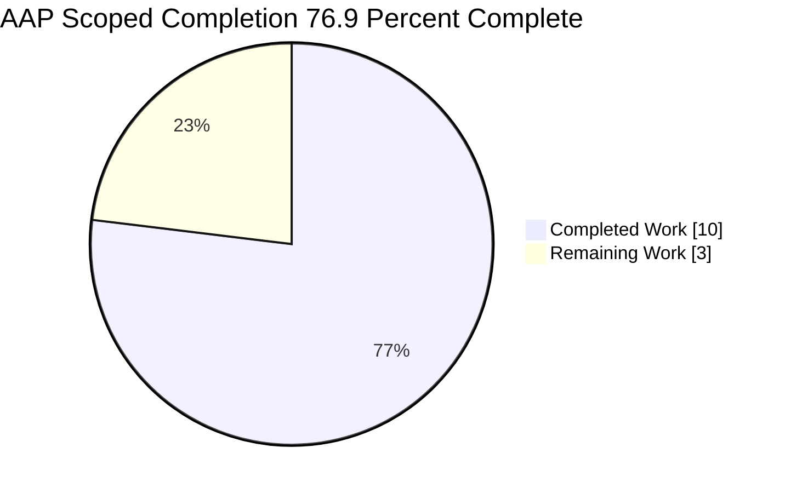
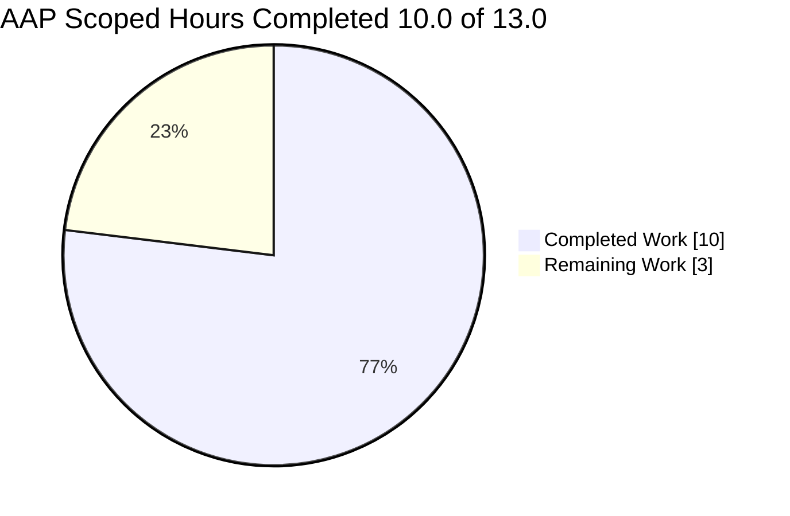

# 1. Executive Summary

`index.js` at the repository root is a two-line Node.js console program that prints `Welcome to Blitzy`. It is delivered complete and verified end to end: the source matches the requested behaviour byte for byte, and the output was exercised rather than assumed. This section states where the project stands, what was delivered and proven, what remains open, and what to do next.

## 1.1 Project Overview

This project delivers one file: `index.js` at the repository root, a two-line JavaScript program whose only behaviour is to print `Welcome to Blitzy` on standard output, unformatted, in as few lines as possible. It runs as `node index.js` with no dependency, manifest, build step or configuration. Its audience is a developer or stakeholder confirming that a request became runnable code: one command, one line of output.

## 1.2 Completion Status

Completion is measured in hours over the plan's scope plus the path to production: 10.0 completed ÷ 13.0 total = **76.9%**. All 67 requirements are delivered and verified; the 3.0 remaining hours are acceptance, runtime assurance and caveat decisions.



**Chart colours:** Completed Work = Dark Blue (#5B39F3); Remaining Work = White (#FFFFFF); the centre label is the completion percentage, **76.9%**.

| Metric | Hours |
|---|---|
| Total Hours | 13.0 |
| Completed Hours (AI + Manual) | 10.0 |
| Remaining Hours | 3.0 |

**Calculation:** 10.0 ÷ 13.0 = **76.9% complete**.

## 1.3 Key Accomplishments

- [x] Prints the requested text exactly: `index.js:2` writes `Welcome to Blitzy`, casing and spacing byte-identical.
- [x] Unformatted: the message and one newline — 18 bytes, no colour, prefix or padding.
- [x] Two lines: a one-line JSDoc summary above the single statement it documents.
- [x] Nothing else: no export, wrapper, argument parsing, error handling, logging or configuration read.
- [x] Nothing to install: no dependency, manifest or build step; `node --check index.js` is the compile step.
- [x] Runs as documented: `node index.js` prints the line, exits 0, empty standard error, about 22 ms.
- [x] Proven three ways: byte comparison, the digest gate `2dc7e85a…c7971951`, and the assertion form.
- [x] One file, smallest diff: `index.js` only — 2 insertions, 0 deletions.

## 1.4 Critical Unresolved Issues

**Open items: 3.** The deliverable is complete and verified (1 of 1 scoped); each item below is a caveat that comes with it, and none stops the program doing what it was asked to do.

| Issue | Impact | Owner | ETA |
|---|---|---|---|
| The output contract is guarded by no check inside the repository, so a future edit to `index.js` would be caught by nothing in the project. | A change to the printed line could ship unnoticed. | Repository owner | Decision with release sign-off; ~2.0 h if a check is added |
| A failed stdout write is silent: with stdout on a full device, a closed descriptor, or a consumer that exits immediately, the message is lost while the process still exits 0 with empty stderr. | A lost line looks like success if the program is ever run from automation. | Repository owner | Decision with release sign-off |
| Output was exercised only on Node v22.23.3; byte invariance on a different runtime major is unverified. | Deployment on another major is unproven. | Deployment owner | 1.5 h before release |

The one-line doc comment and its placement are source-form requirements: they are verified by reading `index.js:1`, not by any executed check.

## 1.5 Access Issues

No access issues identified. The program needs no credential, service, port or repository permission to build, run or verify.

## 1.6 Recommended Next Steps

1. **[High]** Sign off the delivered line and record the release decision (0.5 h).
2. **[High]** Run the gate on the deployment runtime — `node index.js | sha256sum`, expecting `2dc7e85a…c7971951` — and pin that runtime (1.5 h).
3. **[Medium]** Decide whether the output contract should be guarded in the repository and whether the silent loss on a failing stdout needs handling (1.0 h); until then keep the digest gate in the release process.
4. **[Low]** Confirm the exclusions hold — no test file, manifest, lockfile, CI configuration or documentation file — unless the scope is deliberately changed.

# 2. Project Hours Breakdown

Hours are estimated against the work the plan scoped plus the path to production; 10.0 h is complete and 3.0 h remains, for 13.0 h in total. Every figure below traces to a plan requirement or to a path-to-production need.

## 2.1 Completed Work Detail

| Component | Hours | Description |
|---|---|---|
| `index.js` written to the specified form (`index.js:1-2`) | 1.0 | The deliverable itself: one JSDoc summary line above the single `console.log` statement, double-quoted literal, terminating semicolon, final newline, nothing else. Traces to the functional requirements (exact literal, unformatted output, fewest lines, one-line doc comment, nothing else added) and to the file's acceptance criterion. |
| Output-contract verification | 2.5 | Byte-exact confirmation of standard output: the documented run, byte count, line count, byte dump, comparison against the expected bytes, the output digest gate and the published assertion form, plus the unformatted-output audit (no colour, prefix, suffix, padding or structured encoding). |
| Run-and-delivery verification | 1.5 | Syntax gate, the documented run from the repository root, nothing to install, no dependency, manifest or lockfile, exactly one file delivered, smallest possible diff, and the pre-existing `README.md` confirmed byte-identical to the base commit. |
| Behavioural independence and side-effect battery | 3.5 | Invocation contexts (relative and absolute paths, foreign and deleted working directories, `sh -c`, piped, redirected and command-substituted stdout, a pty), argument extremes, emptied and hostile environments, stdin variants, stream-sink variants, repeatability, parallelism, concurrency into one sink, and the before/after tree, socket and working-directory audits. |
| Conformance, comment and security review | 1.5 | Requirement-by-requirement conformance to the plan, the absence sweeps for every construct the request forbids, the accuracy verdict on the single comment, the marker and stub sweep, and the baseline security sweep (credentials, input validation, injection classes, path traversal, unsafe deserialization, crypto misuse, race conditions, sensitive-data exposure, supply chain). |
| **Total** | **10.0** | |

## 2.2 Remaining Work Detail

| Category | Hours | Priority |
|---|---|---|
| Runtime-invariance assurance on the deployment runtime — run the gate on the runtime the program will be deployed on and pin it (path to production) | 1.5 | High |
| Release acceptance and sign-off of the delivered line against the request (path to production) | 0.5 | High |
| Disposition of the accepted caveats and the repository description — whether to guard the output contract inside the repository, whether the silent loss on a failing stdout needs handling, and correction of any reused description that says the repository holds no entries. Any resulting implementation would be separate work outside the delivered scope, which is why only the decision is counted here (path to production) | 1.0 | Medium |
| **Total** | **3.0** | |

## 2.3 Hours Calculation and Confidence

**Formula and figures**

- Completed hours: 10.0 h across the five components in 2.1
- Remaining hours: 3.0 h across the three categories in 2.2
- Total project hours: 10.0 + 3.0 = 13.0 h
- AAP-scoped completion: (10.0 ÷ 13.0) × 100 = **76.9%**

**Confidence**

| Measure | Confidence | Basis |
|---|---|---|
| Completed hours | High | Every figure maps to a file, a run or a check actually carried out; the deliverable is small enough that its whole surface was exercised, not sampled. |
| Remaining hours | High | Three bounded path-to-production items with defined exit criteria (a sign-off, a gate run on the target runtime, and a recorded decision). |
| Completion percentage | High | Both sides of the ratio are stated above and sum to the total; no item outside plan scope or the path to production is counted. |

The completed total reflects the engineering and verification the deliverable required, not the number of lines it produced: the verification depth, not the file size, is what the hours measure. No hours are counted for artefacts the request excludes — a test suite, manifest, lockfile, CI configuration or documentation file — because producing them would breach the scope rather than complete it.

# 3. Test Results

The repository ships no test suite, no test framework, no coverage tool and no CI configuration — a deliberate scope decision, since the request excludes those artefacts. What follows is the verification that was actually executed against the delivered program, run from the repository root with the Node.js runtime and the shell: **24 checks in total, all passing**. There is no coverage percentage because no coverage tooling exists in scope.

| Area / Category | Framework | Tests | Passed | Failed | Coverage | What This Proves |
|---|---|---|---|---|---|---|
| Static validity of the delivered file | Node.js compile step (`node --check`); no test framework in scope | 1 | 1 | 0 | Not applicable — no coverage tooling in scope | The file parses cleanly under the runtime's own compile step, which is the whole build for this project. |
| Output contract — exact text, length, single newline | Shell assertions over the runtime | 4 | 4 | 0 | Not applicable | Standard output is exactly `Welcome to Blitzy` followed by one newline: 18 bytes, one line, byte-identical to the expected bytes. |
| Output digest and published assertion form | Shell (`sha256sum`, `test`) | 2 | 2 | 0 | Not applicable | The printed value matches the published digest `2dc7e85a…c7971951` bit for bit, and the published assertion form holds. |
| Stream discipline and exit status | Shell capture with a timeout guard | 2 | 2 | 0 | Not applicable | The run exits 0 with zero bytes on standard error and completes in ~22 ms, far inside any timeout. |
| Argument independence | Shell | 1 | 1 | 0 | Not applicable | Extra arguments, including `--help` and `-h`, change nothing and produce no usage text — confirming there is no argument parsing. |
| Environment independence | Shell (`env -i`) | 1 | 1 | 0 | Not applicable | With an emptied environment the output is identical, proving the message is a source literal and no configuration or environment value is read. |
| Invocation and location independence | Shell, from a foreign working directory; direct-execution probe | 2 | 2 | 0 | Not applicable | The documented entry works from any directory, and direct execution (`./index.js`) exits 126 by design because the file carries no shebang. |
| Repeatability, concurrency and repository integrity | Shell (parallel runs, digest comparison, `git status`) | 11 | 11 | 0 | Not applicable | Ten parallel runs produce one identical digest with empty standard error, and the runs leave the working tree and repository state untouched. |

**Not Covered**

- **The doc comment and its placement (source form).** That the file carries a single one-line `/** … */` summary, with no `@param`, `@returns`, description or example, and that it sits on its own line above the statement it documents, cannot be observed by running the program. It is established by reading `index.js:1`, not by an executed test.
- **The line count and the file's exact contents.** The two-line form, the double-quoted literal, the terminating semicolon and the final newline were confirmed by inspecting the file and comparing it against the specified contents; no test asserts them at run time.
- **No regression net inside the repository.** Because no test suite, manifest or CI configuration exists here, nothing inside the project re-checks the printed line after a future edit; there is no coverage figure to quote. Re-run the gate in Section 9 after any change to `index.js`.
- **No failure path exists to test.** The request forbids error handling, so there is no non-zero exit and no error message to exercise; a failing stdout is silent by design.
- **Only Node v22.23.3 was exercised.** No other runtime major was available to confirm byte invariance.
- **No browser, UI, network, service or database surface.** None exists in this project, so none was exercised.

# 4. Runtime Validation & UI Verification

- ✅ **Start-up, run and exit** — `node index.js` from the repository root prints the line, exits 0, writes nothing to standard error and finishes in about 22 ms.
- ✅ **Compile step** — `node --check index.js` exits 0; this is the whole build for the project.
- ✅ **The program's only user journey** — a run followed by an exit-status read yields `Welcome to Blitzy` and `0`.
- ✅ **Output gate** — `node index.js | sha256sum` returns `2dc7e85a734de043468d7beb8ee5294e0c04440f23fd89b69fd8ea0ee7971951`, and the assertion form (text equality plus an 18-byte count) holds.
- ✅ **Invocation contexts** — relative and absolute paths, `sh -c`, subdirectory-relative invocation, foreign working directories (`/`, `/proc`, a deleted directory), piped, redirected and command-substituted stdout, and a pty: the single line is emitted unchanged in every one.
- ✅ **Environment independence** — an emptied environment (`env -i`), a hostile colour/locale/timezone environment, Node warning controls, and 100 KB/127 KB variables all produce identical output with empty standard error.
- ✅ **Argument independence** — zero to 5000 arguments, `--help`, `-h`, `--`, and injection-shaped or unicode arguments all produce identical output, with no usage text and nothing executed or echoed.
- ✅ **Stream and stdin variants** — stdin closed, carrying data, empty, and several megabytes; stdout as a pipe, a file, a pty or a capture: output unchanged, and the pty's extra carriage return is shown to be the terminal driver's translation rather than program output.
- ✅ **Repeatability and concurrency** — repeated, parallel and concurrent-append runs produce intact, identical output; the process holds no state and leaves the tree, sockets and working directory unchanged.
- ⚠ **Failing stdout** — with stdout on a full device, a closed descriptor, or a consumer that exits immediately, the message is lost while the process still exits 0 with empty standard error (accepted caveat: reporting it would require error handling the request forbids).

**Never exercised at runtime:** any Node.js major other than v22.23.3; direct execution (`./index.js`, which exits 126 because the file intentionally carries no shebang); any error or non-zero-exit path, which does not exist; and any browser, UI, network, service, database, queue or scheduled-job surface, none of which exists in this project. The program was run locally exactly as documented and in no other deployment environment.

# 5. Compliance & Quality Review

The delivered file is assessed against the benchmarks the request implies — functional conformance, minimality, code and comment quality, scope discipline, operational readiness, security and change discipline — with the status of each stated as it stands. Divergences from the plan and the request are recorded in 5.2.

## 5.1 Compliance Matrix

Each row states where the deliverable stands now against the benchmark applied to it: functional conformance to the request, minimality, security baseline, scope discipline and comment quality.

| # | Deliverable | Benchmark applied | Status | Verified by |
|---|---|---|---|---|
| 1 | Exact message on standard output | Functional conformance | ✅ PASS | `index.js:2`; captured stdout is 18 bytes and byte-identical to `Welcome to Blitzy\n` |
| 2 | Unformatted output | Functional conformance | ✅ PASS | Single string argument; 0 colour, prefix, suffix, padding or encoding bytes; exactly one newline |
| 3 | Fewest-line implementation, summary comment on its own line | Minimality | ✅ PASS | 2 lines / 76 bytes; comment alone on line 1, statement alone on line 2 |
| 4 | One-line doc comment, no tags, description or example | Comment quality | ✅ PASS | `index.js:1`: one `/** … */` line, 0 at-signs |
| 5 | Nothing else in the file | Scope discipline | ✅ PASS | No export, wrapper function, argument parsing, error handling, logging scaffold or configuration read |
| 6 | Language and runtime conventions | Code standards | ✅ PASS | JavaScript executed by Node v22.23.3; no other language's construct |
| 7 | File path and operation | Repository conformance | ✅ PASS | Created at the repository root; git records `A index.js` and the path is absent at the base commit |
| 8 | Scope boundary | Scope discipline | ✅ PASS | One delivered file; no README created or edited, and no manifest, lockfile, dependency, CI configuration, test file or documentation file added |
| 9 | Run contract | Operational readiness | ✅ PASS | `node index.js` from the repository root; nothing to install and no manifest needed |
| 10 | Comment accuracy | Comment quality | ✅ PASS | The comment states exactly what the statement does and claims nothing more |
| 11 | Security baseline | Security | ✅ PASS | No secret, no input surface, no injection path, no dependency supply chain, no attacker-reachable surface |
| 12 | Smallest possible diff | Change discipline | ✅ PASS | 2 insertions, 0 deletions, one file; no unrelated refactor, reformat or rename |

## 5.2 AAP & Rule Divergences and Gaps

Five departures were identified. None leaves the program unable to do what it was asked to do; two carry a caveat a human should decide on, and one is a description of the repository that does not match the tree.

| # | What the AAP / Rule Required | What Was Delivered Instead | Why It Diverged | Impact | Remediation |
|---|---|---|---|---|---|
| D1 | The plan describes the checkout as holding no entries at all and states that no README exists in the repository today. | A tracked 46-byte `README.md` predating this work remains in place, byte-identical to the base commit and referenced by nothing in `index.js`. | The plan's description of the checkout did not match the tree it was written against; its operative instruction was to create no other file and edit none, which was followed. | None at runtime. A reader who trusts the description rather than the tree could mis-scope work. | Rely on the tree; correct any reused description of the repository. No code change needed. |
| D2 | The plan mandates a plain `console.log` and forbids error handling and unrequested hardening. | The mandated call is delivered as specified, so a failed write is not reported: on a full device, a closed descriptor or an early-closing consumer, the message is lost while the process exits 0 with empty stderr. | Detecting the failed write requires the error handling the request forbids; no settlement was available inside scope. | A lost line is indistinguishable from success under those atypical sinks. Ordinary sinks — terminal, pipe, file, pty, capture — are unaffected. | Decide and record whether the sink expectation is acceptable; handling it would change the file the acceptance criterion fixes. |
| D3 | The plan fixes the file's form with no shebang and names `node index.js` from the repository root as the run command. | `index.js` is delivered mode 644 with no shebang, so direct execution `./index.js` exits 126 with "Permission denied". | The mandated form is the reason; adding a shebang would change the file the acceptance criterion fixes. | A user who types `./index.js` gets a permission error instead of the message. | Use the documented command. Adding a shebang is a deliberate re-scope, not a fix. |
| D4 | The request and the plan exclude a test suite, test files, a manifest, a lockfile, CI configuration and unrequested verification artefacts. | Nothing inside the repository checks the printed line: no test, no pipeline step and no coverage figure exists, and the only guard is the output digest gate run from outside. | The exclusions were applied as written; adding a check would have breached the scope rather than completed it. | A future edit to `index.js` would be caught by nothing in the project. | Keep the digest gate in the release process; re-scope if an in-repo check is wanted. |
| D5 | The request asks for as few lines as possible while optimising token usage. | The delivered file is two lines: the summary comment on its own line above the statement it documents, 76 bytes in total. | Sanctioned by the higher source, which requires a one-line `/** … */` summary placed on its own line above the statement it documents; a single line combining both would violate that form. | None: no redundant statement, no blank line and no dead text. | Accept as delivered. Collapsing to one line is a re-scope of the comment requirement, not an improvement. |

**D1 — Repository description versus the tree.** The plan's prose describes the checkout as empty and states that no README exists, while a 46-byte `README.md` dated to the initial commit `1c10c37` sits at the root: its content is the heading `# abk-6298-testing-4f1b7457` and the line `Created by Blitzy`. The delivered code is correct either way — `index.js` neither references nor reproduces it, and the file's blob hash is unchanged between the base commit, the delivered commit and the working tree. The point a reader should take away is that the plan's inventory should not be used as an account of this repository; the tree is authoritative. Correcting a reused description costs minutes and touches no code.

**D2 — A failed stdout write is silent.** `console.log` is fault-tolerant by design: it does not surface a write error, and the request forbids adding error handling, so with stdout on `/dev/full`, closed with `>&-`, or attached to a consumer that exits immediately, the 18 bytes are lost while the process still exits 0 and writes nothing to stderr. A control that writes to the same sinks with a plain Node write call fails loudly with an ENOSPC or EPIPE trace, which is what makes the silence visible rather than hypothetical. The exposure is limited to atypical sinks — terminal, pipe, file, pty and capture all behave correctly. Decide whether that is acceptable for how the program will be run.

**D3 — No direct-execution path.** Because the mandated form carries no shebang and `index.js` is committed mode 644, `./index.js` fails with exit 126 "Permission denied" while `node index.js` works exactly as documented. The file is not executable and should not be: the acceptance criterion fixes its two lines, and a shebang would be a third line and a change to the file the request specified. The practical consequence is only that any wrapper, scheduler or documentation must invoke the program through the runtime rather than as a bare command. Where a pipeline calls it, use `node index.js` and do not rely on the shebang resolution of the operating system.

**D4 — No automated check inside the repository.** The request and the plan exclude test files, a manifest, a lockfile and CI configuration, and those exclusions were honoured: there is no test suite, no framework, no coverage target and no pipeline step in this repository, and therefore no coverage percentage to quote. The verification that exists is the output digest gate — `node index.js | sha256sum` expecting `2dc7e85a734de043468d7beb8ee5294e0c04440f23fd89b69fd8ea0ee7971951` — plus the byte-level comparison, both run from outside the tree. The exposure is that a future edit to `index.js` would be caught by nothing in the project. Keep the gate in the release process, or re-scope if an in-repo check is wanted.

**D5 — Two lines where "as few as possible" was asked (sanctioned).** The request asks for the fewest lines with optimised token usage, and the delivered file is two lines rather than one because the higher source requires a one-line `/** … */` summary positioned on its own line above the statement it documents — a JSDoc block appended to the statement on the same line would satisfy neither requirement. The result carries no waste: 76 bytes, one statement, one semicolon, no blank line, no dead text and no redundant construct. Reviewers who query the line count should read it as the requested minimum expressed under the mandated comment form, not as drift from the minimality instruction.

# 6. Risk Assessment

Risks below are forward-looking: what could still go wrong once this program is in use.

| Risk | Category | Severity | Probability | Mitigation | Status |
|---|---|---|---|---|---|
| A future edit to `index.js` changes or breaks the printed line, and nothing inside the repository catches it. | Technical | Medium | Medium | Keep the output digest gate in the release process; add an in-repo check only if the scope is deliberately expanded. | Accepted — open item 1 |
| Output was verified only on Node v22.23.3; another runtime major could in principle differ. | Technical / Integration | Low | Low | Run the gate on the deployment runtime and pin that runtime; the program uses only a built-in, so the exposure is small. | Open — 1.5 h |
| A failed stdout write is silent, so under automation a lost line looks like success. | Operational | Low | Low | Assert the captured output (18 bytes, or the digest) rather than the exit status wherever the run matters. | Accepted caveat |
| Changing the message text means editing the file and re-verifying the output by hand, with no test to lean on. | Technical | Low | Medium | Re-run the documented gate — syntax check, run, digest — after any edit. | Accepted |
| The program carries no health, logging or monitoring signal beyond its exit status. | Operational | Low | Medium if promoted into a scheduled job or pipeline step | Wrap the invocation with an output assertion instead of relying on exit status, or keep it a manual run. | Open |
| The repository holds no in-tree instruction for running the program, by design. | Operational | Low | Low | This guide documents the command and the expected output; add an in-tree note only if the scope is expanded. | Accepted |
| No dependency, credential, network call, filesystem write or input surface exists, so the supply-chain, secret and input-validation risk classes are empty. | Security | Low | Low | No action required; keep it that way if the program is ever extended. | Accepted |
| Deployment is a single command with no manifest or configuration — nothing to build or migrate — but any wrapper must not read exit status as proof that the line was written. | Integration | Low | Low | Have the wrapper assert the output it captures. | Open |

# 7. Visual Project Status

Completion is AAP-scoped and measured in hours: 10.0 h complete out of 13.0 h total, with 3.0 h remaining.



**Legend:** Completed Work = Dark Blue (#5B39F3); Remaining Work = White (#FFFFFF). Centre label value: **76.9%** complete.

**Remaining hours by category** (from 2.2; the values sum to the 3.0 h shown above):

| Category | Hours | Priority |
|---|---|---|
| Runtime-invariance assurance on the deployment runtime | 1.5 | High |
| Release acceptance and sign-off of the delivered line | 0.5 | High |
| Disposition of the accepted caveats and the repository description | 1.0 | Medium |
| **Total remaining** | **3.0** | |

**Completed hours by component** (from 2.1; the values sum to 10.0 h):

| Component | Hours |
|---|---|
| `index.js` written to the specified form | 1.0 |
| Output-contract verification | 2.5 |
| Run-and-delivery verification | 1.5 |
| Behavioural independence and side-effect battery | 3.5 |
| Conformance, comment and security review | 1.5 |
| **Total completed** | **10.0** |

**Priority distribution of remaining work:** High 2.0 h, Medium 1.0 h, Low 0.0 h.

# 8. Summary & Recommendations

**What was delivered and verified.** `index.js` at the repository root is a two-line Node.js program — a one-line JSDoc summary above a single `console.log` statement — that writes `Welcome to Blitzy` to standard output, unformatted, and nothing else. It runs as `node index.js` with no dependency, manifest, lockfile, build step or configuration, and it was exercised rather than assumed: 24 executed checks covering the exact output bytes, the output digest gate, stream discipline and exit status, argument, environment and working-directory independence, repeatability and concurrency, and repository integrity, all of which passed. Every one of the 67 requirements the plan set is delivered and verified. Completion stands at **76.9%** — 10.0 h of the 13.0 h scoped, with no coding outstanding.

**What remains.** Three items, all path to production: sign-off of the delivered line (0.5 h), assurance that the output is byte-identical on the runtime it will be deployed on plus pinning that runtime (1.5 h), and a recorded decision on the two accepted caveats — that nothing inside the repository guards the printed line, and that a failed stdout write is silent (1.0 h). The first two are gates; the third is a judgement the owner should make explicitly rather than inherit. Together they are the 3.0 h of remaining work, and none of them changes the program's behaviour.

**Critical path to production.** The path is short because the deliverable carries no build, no dependency and no configuration: release is a checkout plus `node index.js`. The sequence is (1) sign off the printed text against the request, (2) run the output gate on the deployment runtime and pin that runtime, (3) record the caveat decision, and (4) keep the gate in the release process as the project's only automated check. Nothing on that path requires a code change; a change to the file would instead invalidate the verification recorded here and should be followed by a fresh gate run.

**Success metrics.** The output is exactly 18 bytes, byte-identical to `Welcome to Blitzy\n`, and matches the published digest `2dc7e85a734de043468d7beb8ee5294e0c04440f23fd89b69fd8ea0ee7971951`. A clean run exits 0 with zero bytes on standard error in about 22 ms. The change is one file, 2 insertions and 0 deletions, with the pre-existing `README.md` untouched. The program has no dependency, no network call, no filesystem write, no input surface and no attacker-reachable path.

**Production readiness.** The program is ready for the use it was specified for — a prototype single-file console program whose entire behaviour is one line on standard output. Its residual risks are structural and accepted rather than latent defects: the output contract is guarded only by the external digest gate, a failed write is silent under atypical sinks, and the runtime expectation should be pinned at deployment. Beyond that, nothing remains to harden, instrument or configure inside the delivered scope, and the exclusions the request set — no test file, manifest, lockfile, CI configuration or documentation file — should stay in place unless the owner deliberately re-scopes.

# 9. Development Guide

**System prerequisites**

- Node.js 22.x — verified on **v22.23.3** (`/usr/bin/node`). The program uses only the built-in `console.log`, so no package manager, compiler, service or container is required.
- Git, to check out the repository.
- A POSIX shell with `sha256sum`, `cmp`, `wc` and `od` for the verification commands below.

**Repository contents and layout**

```text
/
├── index.js     # the deliverable — prints "Welcome to Blitzy"
└── README.md    # pre-existing workspace note, not part of the deliverable
```

**Environment setup and dependencies**

There is **nothing to install**: no manifest, lockfile, `node_modules`, virtual environment, database, broker, cache or port, and no environment variable, secret, token or credential to supply. Do not create a manifest or a lockfile — the project's scope excludes them.

```bash
# Confirm the runtime
node --version            # v22.23.3
command -v node           # /usr/bin/node

# Confirm there is nothing to install
ls package.json node_modules 2>/dev/null || echo "no manifest and no node_modules — nothing to install"
```

**Build**

There is no build system. The syntax check is the whole compile step.

```bash
cd <repository root>
node --check index.js && echo "syntax OK"     # exit 0
```

**Startup and run**

```bash
node index.js
# Welcome to Blitzy
echo $?                   # 0
```

Expected output: exactly `Welcome to Blitzy` followed by one newline — 18 bytes, no colour, no prefix, no padding, nothing on standard error. A run takes about 22 ms. No service, port or background process is started, and nothing needs stopping afterwards.

**Verification steps**

```bash
# 1. Size and stream discipline
node index.js | wc -c                          # 18
node index.js | wc -l                          # 1
node index.js 2>&1 >/dev/null | wc -c          # 0 (nothing on stderr)

# 2. Byte-for-byte identity with the expected value
node index.js | cmp - <(printf 'Welcome to Blitzy\n') && echo "byte-identical"

# 3. The output digest gate
node index.js | sha256sum
# 2dc7e85a734de043468d7beb8ee5294e0c04440f23fd89b69fd8ea0ee7971951  -

# 4. The equivalent assertion form
test "$(node index.js)" = "Welcome to Blitzy" && test "$(node index.js | wc -c)" -eq 18 && echo "assertions pass"
```

Note the distinction between the two digests: `sha256sum index.js` covers the source file (`470b5dbd…`), while the gate above covers the program's **output** (`2dc7e85a…`). Only the output digest is the acceptance value.

**Example usage**

```bash
# Plain run
node index.js                                  # Welcome to Blitzy

# Capture the line in a shell variable
msg=$(node index.js); echo "[$msg]"            # [Welcome to Blitzy]

# Inspect exactly what was written
node index.js | cat -A                         # Welcome to Blitzy$

# Run from any working directory with an absolute path
(cd / && node /path/to/repository/index.js)    # Welcome to Blitzy

# Run it with an emptied environment (no configuration is read)
env -i /usr/bin/node index.js                  # Welcome to Blitzy
```

**Troubleshooting**

| Symptom | Cause | Resolution |
|---|---|---|
| `./index.js: Permission denied` (exit 126) | The file is mode 644 with no shebang, by design | Invoke it through the runtime: `node index.js` |
| `node: command not found` | Node.js is not on `PATH` | Install Node.js 22.x or call the runtime by absolute path (`/usr/bin/node index.js`) |
| Nothing printed, exit status 0, stdout redirected to a full device or a closed descriptor | `console.log` does not surface a write failure, and error handling is excluded from scope | Write to a normal sink (terminal, pipe, file); if the run matters, assert the captured output rather than the exit status |
| Output appears to contain an extra carriage return on a terminal | The terminal driver's newline translation, not the program | Capture the output (`node index.js \| wc -c` → 18) or compare it with `cmp` as above |
| The output carries colour, a prefix or padding | A different implementation is being run | Run the delivered file at the repository root; it writes one constant literal with no formatting |
| `node --check index.js` fails | The file has been edited and no longer parses | Restore its two lines: the JSDoc summary and `console.log("Welcome to Blitzy");` |
| The digest differs from the gate value | The printed text has changed | Compare the output with `printf 'Welcome to Blitzy\n'` and correct the file |

**Operational notes.** The program creates no file, log, socket or state, so there is nothing to clean up, rotate or restart. Because it has no manifest, its entire deployment is a checkout of the file plus a Node.js runtime; if it is ever called from automation, have the caller assert the output it captures rather than trusting exit status 0.

# 10. Appendices

Reference material for building, running, verifying and operating the delivered program. Every command shown was run from the repository root and produced the result in the table.

## A. Command Reference

| Command | Purpose | Expected result |
|---|---|---|
| `node --version` | Confirm the runtime | `v22.23.3` |
| `node --check index.js` | Syntax check — the entire build step | exit 0, no output |
| `node index.js` | Run the program | `Welcome to Blitzy`, exit 0 |
| `node index.js \| wc -c` | Output size in bytes | `18` |
| `node index.js \| wc -l` | Output line count | `1` |
| `node index.js 2>&1 >/dev/null \| wc -c` | Standard-error size | `0` |
| `node index.js \| cmp - <(printf 'Welcome to Blitzy\n')` | Byte-for-byte identity with the expected value | exit 0, no output |
| `node index.js \| sha256sum` | The output digest gate | `2dc7e85a734de043468d7beb8ee5294e0c04440f23fd89b69fd8ea0ee7971951` |
| `test "$(node index.js)" = "Welcome to Blitzy" && test "$(node index.js \| wc -c)" -eq 18` | The equivalent assertion form | both conditions true |
| `env -i /usr/bin/node index.js` | Prove no environment or configuration value is read | the same line |
| `(cd / && node /path/to/repository/index.js)` | Prove the run does not depend on the working directory | the same line |
| `timeout 10 node index.js` | Guard against a hang | the same line, exit 0 in about 22 ms |
| `node index.js \| cat -A` | Show the exact bytes; a line end is shown as `$` | `Welcome to Blitzy$` |

## B. Port Reference

No port is bound, opened, listened on or required. The program makes no network call and starts no server, so nothing needs to be reserved or published, and no port conflict can occur at deployment.

| Port | Protocol | Used by | Purpose |
|---|---|---|---|
| — | — | — | None |

## C. Key File Locations

| Path | Purpose |
|---|---|
| `index.js` | The whole deliverable: the one-line JSDoc summary and the single `console.log("Welcome to Blitzy");` statement. |
| `README.md` | A pre-existing 46-byte workspace note (`# abk-6298-testing-4f1b7457` and `Created by Blitzy`). Untouched by this work and not part of the deliverable. |

## D. Technology Versions

| Component | Version | Notes |
|---|---|---|
| Node.js | v22.23.3 | At `/usr/bin/node`; the only runtime requirement. Only the built-in `console.log` is used, so behaviour does not depend on the runtime's module system. |
| Git | 2.54.0 | Used to check out and inspect the repository; the repository's hooks are standard Git LFS hooks. |
| Project dependencies | none | No manifest, lockfile or `node_modules`; nothing to install or update. |
| Build system | none | `node --check index.js` is the whole compile step. |
| Test framework, coverage tool, linter | none | Deliberately outside the project's scope. |

## E. Environment Variable Reference

**Required: none.** The program reads no environment variable and no configuration file — an emptied-environment run (`env -i /usr/bin/node index.js`) produces the identical 18 bytes, which proves the message is a compile-time literal in the source.

Variables that were set during verification and had no effect on the output: `FORCE_COLOR`, `NO_COLOR`, `TERM`, `COLORTERM`, `LANG`, `LC_ALL`, `TZ`, `NODE_OPTIONS`, `NODE_NO_WARNINGS`, `PATH`, `HOME` and `TMPDIR`.

## F. Developer Tools Guide

| Tool | Present | Use in this project |
|---|---|---|
| `node` (`/usr/bin/node`) | Yes, v22.23.3 | Runs the program and performs the syntax check. |
| `npm` / `npx` | Present but unused | There is no manifest and no dependency, so neither is invoked. |
| `git` | Yes, 2.54.0 | Checkout, history and tree inspection. |
| `sha256sum` | Yes | The output digest gate. |
| `cmp` | Yes | Byte-for-byte comparison of the output with the expected value. |
| `wc`, `od`, `cat -A`, `stat` | Yes | Counting bytes and lines, inspecting exact bytes, and reading file metadata. |
| `timeout`, `script` | Yes | Bounding a run and comparing terminal (pty) output with a redirected capture. |
| `ss`, `netstat`, `lsof` | **Absent** | Port discovery must use `/proc/net/tcp` and `/proc/net/tcp6`; sockets in LISTEN state appear as state `0A`. |

## G. Glossary

| Term | Meaning |
|---|---|
| AAP | The agreed plan that scoped this work: one file, its exact contents, its run command and its exclusions. |
| JSDoc summary | The one-line `/** … */` comment that documents the statement beneath it. |
| Output digest gate | Hashing the program's standard output and comparing it with the accepted value `2dc7e85a…c7971951`; it is the only automated check this project has. |
| Standard output / standard error | The two streams a console program can write to. This program writes only the first, and never the second. |
| Exit status | The number the process returns to its caller; `0` means success. |
| Byte-identical | Equal byte for byte, including the single trailing newline — 18 bytes in total. |
| ONLCR | The terminal driver's translation of a newline into carriage return plus newline, which is why a terminal capture can appear to contain an extra `\r`. |
| Prototype | This deliverable's classification: a single-file console program with no operational surface, no state and no configuration. |
| Path to production | The work between a verified deliverable and a released one: acceptance sign-off, runtime assurance and recorded decisions. |
